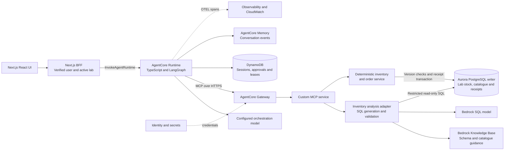

# Running Bench on Amazon Bedrock AgentCore

**Status: proposed; not implemented or deployed.** This design extends the existing local build with real-time, lab-scoped inventory analysis. AWS documentation was checked on October 14, 2026. No AWS account was used. The submitting developer should review these choices and add their own rationale before submission.

The selected design uses a Bedrock model with retrieved schema/catalogue context to generate PostgreSQL queries. A custom MCP service validates those queries and executes them against live Aurora inventory. Bedrock Knowledge Bases supply reference context; they do not supply current stock counts. The [detailed RAG design](docs/architecture/AgentCore-RAG-Design.md) defines freshness, SQL controls, lab isolation, purchase revalidation and verification gates.

## Proposed boundary

Next.js stays outside Runtime as the web application and backend-for-frontend (BFF). The portable agent modules in `server/` run in Runtime with a small HTTP adapter. The Runtime [HTTP contract](https://docs.aws.amazon.com/bedrock-agentcore/latest/devguide/runtime-http-protocol-contract.html) requires an ARM64 container listening on `0.0.0.0:8080`, a `POST /invocations` endpoint, and a `GET /ping` health endpoint. The adapter maps the existing user/session/message contract to `/invocations`. Build an ARM64 agent-only image, push it to ECR, and configure the execution role and runtime endpoint. The local combined container instead exposes Next.js on port 3000.

## Services to use

**Runtime:** Keep LangGraph orchestration, model adapters, proposal policy, and retry/idempotency semantics. Use Runtime for hosting and runtime session isolation. Map each authenticated application session to a Runtime session ID; never use that ID as proof of ownership. The user can approve hours later, after any particular runtime process has ended, so business state must remain external. Runtime supports HTTP and MCP contracts; this proposal uses HTTP for the agent. [Service contract](https://docs.aws.amazon.com/bedrock-agentcore/latest/devguide/runtime-service-contract.html)

**Gateway:** Replace local stdio with authenticated MCP over HTTPS and register the custom MCP service as a gateway target. Gateway provides centralized tool access, authentication, and credential injection. Keep the existing tool schemas and model allowlist; the service must still enforce approval, ownership, and business limits. Do not treat gateway authentication alone as permission to purchase. With this small tool set, semantic tool discovery is unnecessary. Before registration, check target support, transport compatibility, and any naming/prefix changes against the client's tool mapping. [Gateway documentation](https://docs.aws.amazon.com/bedrock-agentcore/latest/devguide/gateway.html)

**Bedrock model and Knowledge Bases:** Add an application-controlled analysis tool behind MCP. It retrieves approved schema/catalogue guidance, asks a Bedrock model for SQL, validates it, then uses a restricted database role. This needs a new cloud model/tool adapter; the current application providers remain demo, OpenAI and Ollama. Bedrock's native structured-KB configuration uses a Redshift query engine with supported Redshift/Glue stores; it is not a native Aurora connector. That path was considered but is not the selected primary design. [Structured-store prerequisites](https://docs.aws.amazon.com/bedrock/latest/userguide/knowledge-base-prereq-structured.html)

**Aurora PostgreSQL:** Own lab inventory, shared approved catalogue records and durable order receipts in the same operational database. Fresh analysis uses read-only transactions on the writer endpoint, which AWS documents as supporting reads against the primary instance. The purchase service has a separate write role. This replaces the earlier proposed DynamoDB receipt store so purchase-time inventory checks and receipt creation can share a transaction. [Writer endpoint](https://docs.aws.amazon.com/AmazonRDS/latest/AuroraUserGuide/Aurora.Endpoints.Cluster.html)

**Memory:** Use short-term conversation events keyed by trusted actor/user and session IDs. Long-term extraction can be added for noncritical preferences, but this build needs only a lab preference. Keep the explicitly confirmed lab in the transactional application store initially; that avoids eventual extraction changing an order destination. AgentCore Memory can hold conversational context without serving as an approval ledger or ordering database. Access filters must be derived from authenticated identity, and retention/deletion settings must match the application policy. [Memory documentation](https://docs.aws.amazon.com/bedrock-agentcore/latest/devguide/memory.html)

**Identity:** Replace fixed browser demo tokens with a real identity provider. Derive user identity from verified authentication and validate active-lab membership server-side. The saved delivery-lab preference does not grant lab access. Enforce lab-scoped inventory access and user-private orders/memory at the application and database boundaries. Use appropriate inbound Runtime/Gateway authentication and AgentCore Identity for supported outbound credential flows. Store workload credentials and the signing secret in a managed secret store. End-user authorization for a purchase remains application logic. [Identity documentation](https://docs.aws.amazon.com/bedrock-agentcore/latest/devguide/identity.html)

**Observability:** Export the existing trace structure as OTEL spans linked across Runtime, Gateway, MCP, and the order backend. Include model usage, latency, tool errors, retry count, proposal ID, and order receipt ID; redact bearer tokens, signed proofs, and unnecessary conversation content. Use CloudWatch-backed AgentCore dashboards to locate a failed run and distinguish inference failures from supplier failures. Set explicit retention and alert thresholds for timeout/error rates. [Observability documentation](https://docs.aws.amazon.com/bedrock-agentcore/latest/devguide/observability.html)

No Browser or Code Interpreter is needed: the agent uses structured APIs and never executes arbitrary user code.

## Durable state and write safety

Replace machine-local SQLite with two deliberately separate ownership boundaries. DynamoDB holds sessions, user preferences, approval workflow, HTTP replay records and leases. Conditional writes guard ownership and workflow transitions. Aurora holds operational inventory/catalogue data and purchase receipts. AgentCore Memory holds conversational events rather than authoritative purchase decisions.

Each cloud proposal includes requested packs, authorized lab ID and stock/catalogue versions alongside its exact approved details. The deterministic order service serializes attempts for a proposal key and returns an existing receipt first. For a new receipt, it holds `SELECT ... FOR UPDATE` locks on the relevant stock/catalogue rows through version validation and receipt/outcome commit in Aurora. A changed source version produces a definitive stale rejection; the workflow retires that proposal and obtains a new proposal and human approval. It never silently changes an approved quantity or price.

The DynamoDB approval and Aurora receipt are not one transaction. After an uncertain response, retain approval and reconcile the original key before treating it as stale or creating a replacement. A committed receipt wins over later stock changes. Only a definitive no-order rejection permits re-proposal. A real supplier remains another transaction boundary; supplier idempotency or an outbox/reconciliation adapter would be needed before promising duplicate prevention there.

Only pending proposals expire automatically. Approved uncertain writes remain recoverable. Enforce expiry in code; database TTL is cleanup. Distributed leases require version/fencing checks. The detailed design describes these as proposed changes, including a cloud-only superseded-proposal outcome; the local implementation retains its existing four statuses.

## Real-time analysis contract

Real-time means reading committed operational inventory at the start of database execution in a fresh request transaction. A few seconds of context retrieval, generation and query latency are acceptable; results do not continuously update after the snapshot. Use the writer endpoint, avoid a lagging reporting copy or cached stock answers, and expose read timestamps. Reader replicas have replication lag, and AWS recommends the cluster endpoint when read-after-write consistency is required. This is a design requirement, not a measured latency SLO. [Aurora consistency guidance](https://docs.aws.amazon.com/AmazonRDS/latest/AuroraUserGuide/aurora-poc.html)

Analysis cannot authorize a purchase. Proposal creation still performs an authoritative point read through MCP, and the order transaction revalidates its versions at commit.

## Changes from the local build

| Local implementation               | Proposed cloud change                                                                                           |
| ---------------------------------- | --------------------------------------------------------------------------------------------------------------- |
| Global seeded stock in mock SQLite | Lab-keyed stock and shared approved catalogue in Aurora.                                                        |
| Exact search/read tools            | Preserve them and add a bounded read-only analysis tool.                                                        |
| Local Markdown workflow skills     | Retain them; add a Bedrock KB for curated schema/catalogue context.                                             |
| Demo/OpenAI/Ollama adapters        | Add Bedrock SQL generation within the analysis adapter.                                                         |
| Agent SQLite workflow              | DynamoDB state, replay and conditional leases.                                                                  |
| Mock SQLite receipts               | Aurora receipts beside versioned stock/catalogue records.                                                       |
| Proposal without source versions   | Bind requested quantity, lab ID and source versions to approval; re-propose after a definitive stale rejection. |

The local build and its recorded evaluations do not implement or validate these cloud changes. The combined local Dockerfile is not an AgentCore-ready image.

## What needs verification before relying on it

- Regional service availability, model access, IAM permissions, network paths, quotas, cost, and Runtime session limits.
- Node.js ARM64 image, health checks, graceful termination, and compatibility of the pinned TypeScript dependencies.
- MCP remote transport, Gateway target authentication, credential injection, exact tool naming, and error envelopes.
- Trusted actor propagation and whether a user can retrieve another actor's memory through any API path.
- Database-enforced lab isolation under actual non-owner roles, views and pooled connections; shared catalogue access must not expose another lab's stock or another user's orders.
- SQL semantic accuracy, unsafe-query rejection, schema-context drift, query/result limits and writer-load impact under representative inventory questions.
- Controlled commits observed by new analysis requests, with failover and timeout behavior that never substitutes stale KB stock answers.
- Memory consistency, retention and deletion behavior; no extracted preference should silently alter approved details.
- A process killed after approval, a response lost after order commit, concurrent duplicate approvals, stale-version rejection and delayed retries following secret rotation.

The difficult migration is identity propagation, safe generated SQL and recovery across the DynamoDB/Aurora boundary. Keep immutable proposals, explicit approval, signed details, durable receipt keys and traceable recovery. Resolve the verification gates in the [detailed design](docs/architecture/AgentCore-RAG-Design.md) before deployment.
