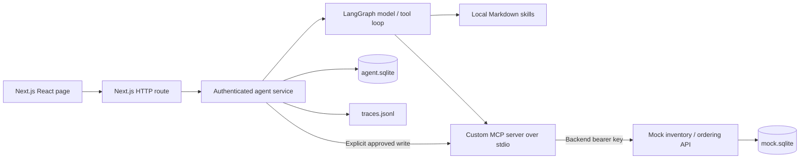

# Bench — Lab Supplies Agent

A local TypeScript / Next.js / LangGraph application that checks lab stock through an MCP server, searches approved suppliers, and proposes a purchase order. The actual order is written only after the user explicitly approves in a later message.

**Development status:** AI-assisted implementation. Deterministic evaluations exercise the real services; they are not evidence of language-model quality. See `evidence/eval-demo.txt` for the latest executed results. Live-model results are reported only if `npm run eval -- --live` has actually run. The personal reflection prompts below must be reviewed and completed by the submitting developer.

## Documentation

Start with the [application documentation index](docs/README.md) for separate architecture, database, HTTP API, MCP, frontend, backend, skills, operations, testing and security guides. Shared domain terms are defined in [GLOSSARY.md](GLOSSARY.md). The [AgentCore proposal](AGENTCORE.md) describes a future cloud deployment.

## Quick setup

Requires Node.js 24+ and npm. No AWS account is required.

```sh
npm ci
cp .env.example .env
npm run dev
```

Open [http://localhost:3000](http://localhost:3000). One command starts Next.js on 3000, the agent API on 3001, and the authenticated mock on 3002. All bind to loopback locally. The service spawns the MCP server over stdio for each request and closes it afterwards.

The initial `MODEL_PROVIDER=demo` is an explicitly labeled **deterministic test double**, useful for key-free demonstrations and infrastructure evaluations. It is not an LLM agent. Use an actual model for the assignment demonstration:

```dotenv
MODEL_PROVIDER=openai
MODEL_NAME=gpt-4.1-mini
OPENAI_API_KEY=your-key
```

Alternatively, install a tool-capable Ollama model and configure:

```dotenv
MODEL_PROVIDER=ollama
OLLAMA_URL=http://127.0.0.1:11434
OLLAMA_MODEL=qwen3:8b
```

Model names are configurable examples; verify availability and tool support with your provider. Restart the services after changing `.env`. OpenAI uses [Chat Completions function calling](https://developers.openai.com/api/docs/guides/function-calling); Ollama uses its [chat API](https://docs.ollama.com/api/chat). Keys stay on the server. Do not paste them into the browser or commit `.env`.

### Walk through a run

1. Select Maya. Send `My lab is Molecular Biology`.
2. Send `Check stock of 200 µL pipette tips`. Expand the activity trace to inspect the search and read arguments/results.
3. Send `I need 5 boxes of 200 µL pipette tips`. Two boxes are in stock; the proposal purchases three boxes for $73.50.
4. Restart the service before approving to see that the pending proposal remains.
5. Select **Write committed · response lost** in Failure Lab, then approve. The first write commits and loses its response; a retry retrieves the same order.
6. Open Purchase orders. Select Flaky and run another stock check to observe a 429, a 503, and recovery. Persistent errors or Slow demonstrate exhausted retries and a clear failure reply.

Use **New session** to demonstrate cross-session lab memory. Switch to Theo to see separate memory and order history. Defaults are public local-demo credentials, not production accounts. `DEMO_USERS_JSON` configures the bearer-token mapping; replace browser demo tokens manually using the credentials field if custom tokens are configured.

### HTTP API

The frontend uses `POST /api/chat`; the agent service also exposes `POST /chat` directly. Required body fields are `userId`, `sessionId`, and `message`. Optional `requestId` enables response replay; optional `proposalId` binds a decision to the proposal shown in the UI. Every conversation request requires the user's bearer token.

```sh
curl http://localhost:3000/api/chat \
  -H 'Content-Type: application/json' \
  -H 'Authorization: Bearer demo-maya-token' \
  -d '{"userId":"maya","sessionId":"example","message":"Check stock of ethanol"}'
```

The response includes `reply`, `proposal` (or null), optional `order`, `traceId`, and structured `events`. To approve, send a new message containing `approve` with the same user/session and the returned proposal ID. `GET /api/session?sessionId=…` restores conversation, lab, proposal, and latest trace. `GET /api/orders` lists only the authenticated user's orders. The local `/api/faults` endpoint reads or configures test failures through MCP.

## Architecture



The agent has no inventory database imports or direct mock HTTP calls. Search, reads, writes, order-history reads, and local fault administration all pass through MCP. Test assertions can call the mock directly to verify its authentication boundary.

Next.js provides React and HTTP routing. The agent is a separate service so hot reload does not own long-running orchestration and the same modules can later run in AgentCore. LangGraph implements a bounded `model → tools → model` loop. Plain imperative orchestration and the OpenAI Agents SDK are reasonable alternatives, but this build uses LangGraph to make the model/tool boundary explicit and honor the named framework in the brief. No optional multi-agent, streaming, or cancellation feature is included.

## Application skills

The agent has two reusable workflow skills:

| Skill                                                  | Use                                                                                                            |
| ------------------------------------------------------ | -------------------------------------------------------------------------------------------------------------- |
| [stock-check](skills/stock-check/SKILL.md)             | Search inventory, follow pagination, read the exact SKU, and report stock and location.                        |
| [purchase-planning](skills/purchase-planning/SKILL.md) | Clarify pack quantities, check stock, find the approved catalogue item, and propose buying only the shortfall. |

The system prompt contains the skill names and descriptions. The model uses the local `read_skill` tool to load a skill's Markdown instructions into its tool conversation before choosing supply tools. A purchase uses both skills. Skill loads appear as `skill` events in the existing activity trace, separate from MCP calls.

Try `Check stock of ethanol` for stock-check or, after saving a lab, `I need 5 boxes of 200 µL pipette tips` for both skills. No special command or skill selector is required. The demo fixture selects skills deterministically; OpenAI and Ollama receive the same catalog and tool, but their skill-selection quality still needs live evaluation.

These are **application agent skills**, stored in the repository. They are not installed as Codex development skills. `read_skill` reads only registered local instructions; inventory, catalogue and order access still go through MCP. Skills provide procedural guidance. Service code continues to enforce purchase validation, human approval and idempotency, and `create_purchase_order` remains unavailable to the model.

To change a workflow, edit its `SKILL.md` and restart the agent. To add a skill, create `skills/<name>/SKILL.md` and register its name in [server/skills.ts](server/skills.ts). This small loader supports exactly two plain, single-line frontmatter fields, `name` and `description`, in that order, followed by the Markdown body. It rejects unregistered names and paths. Add behavioral evaluations for the new workflow; update the deterministic fixture if it should demonstrate that skill. The registry is loaded at process startup, so invalid or missing registered files prevent startup. Loading a skill does not execute scripts or grant additional tool permissions.

## State, approvals, and memory

SQLite uses WAL and a busy timeout. Session state is keyed by **authenticated user plus session**, never by session alone. The API rejects a request user that differs from the bearer identity. Durable session leases reject overlapping requests; a crashed process's lease expires after the request budget plus ten seconds.

Approval lifecycle: `pending → approved → completed`, or `pending → declined`. A pending proposal stores the exact SKU, supplier, quantity, price, lab, owner, and session before returning to the user. Only exact approval messages (`approve`, `yes`, `approved`, `confirm`) authorize it. Quoted approval, altered details, and unrelated text do not. UI decisions include the proposal ID; stale IDs are refused. Pending proposals expire after 24 hours, checked when the session next receives a message. Expiry closes the proposal without ordering.

The model gets `propose_purchase_order`, not the privileged MCP write. Before proposing, the service requires inventory search, catalogue search, and a read of the exact item. It checks the saved lab, approved supplier, quantity bounds, and a $5,000 limit. Explicit numeric requests are checked against the stock shortfall. The backend checks price again before committing.

Approval is stored before calling the write. The service signs a short-lived HMAC proof binding the proposal and purchase details. The mock verifies it and stores the order under a unique proposal-based idempotency key. After an ambiguous failure, approval remains saved and **Retry** reuses the same key. An already approved order cannot be declined while its outcome is unknown. Proofs are internal credentials and redacted from traces.

Recent conversation: last 40 user/assistant messages, with sessions older than 30 days removed during subsequent requests. Cross-session memory: only an explicitly declared lab (`My lab is …`), one value per user, usable for 90 days; expired values are physically cleaned during subsequent requests. No automatic extraction of sensitive facts or vector store. Purchase/approval records and trace files are retained until local data is removed. Before each uncached chat, response-cache cleanup keeps the newest 10,000 entries globally; the next insert can temporarily exceed that count. This is a single-machine design; see cloud storage changes in [AGENTCORE.md](AGENTCORE.md).

## Tools and failure handling

| Tool                    | Purpose                                                                             |
| ----------------------- | ----------------------------------------------------------------------------------- |
| `search_supplies`       | Search `inventory` or approved `catalogue`; cursor pagination and bounded page size |
| `read_supply`           | Read authoritative pack unit, stock, supplier, price in cents, and lead time        |
| `create_purchase_order` | Privileged signed, idempotent write; never exposed directly to the model            |
| `list_orders`           | Order-history read with user scope injected by the service                          |
| `configure_faults`      | Local test administration; hidden from the model                                    |

Schemas and descriptions distinguish stock checks from purchasing and pack quantities from individual tips or milliliters. MCP SDK validation rejects malformed arguments. MCP authenticates to the mock with `MOCK_API_KEY`. Model-visible tools are allowlisted; model text cannot mint an approval proof.

Errors use MCP `isError` with JSON code, message, retryability, and optional retry-after duration. The broker retries transient errors at most three times with exponential backoff, jitter, and a bounded retry-after. Each backend attempt has a 1.2-second default timeout; the overall request budget is 20 seconds. Permanent errors do not retry. Exhausted tool errors enter graph state as tool messages; the model receives the error and the service returns an honest failure response. Purchasing happens outside the model loop, so its ambiguous-outcome reply explicitly says an order may already exist.

Failure modes are deterministic for reproducibility: off, cyclic flaky `429 → 503 → success`, persistent 429, persistent 503, slow responses, and a lost response after a committed write. `ALLOW_FAULT_CONTROL=false` disables the switch. Faults are global to the local mock, so simultaneous users share test conditions.

## Quality and evidence

Latest local verification: **19/19 deterministic integration evals and 7/7 unit/protocol tests passed**, including skill selection, loading and registered-path restrictions. Type checking, formatting and a production Next.js build passed. Browser evidence covers a stock read, a proposed write, the approved order, transient failure recovery, and timeout exhaustion. Live-model evals have not been run because no provider credentials or local Ollama installation were available. Docker Compose configuration validates; image execution has not been tested because the local Docker daemon is stopped.

```sh
npm run typecheck
npm run format:check
npm test
npm run eval
npm run build
# With a configured actual provider:
npm run eval -- --live
```

The eval runner starts isolated mock and agent processes on free ports with a fresh temporary data directory. It checks actual traces and stored orders, not just reply wording. Coverage includes skill selection before MCP reads, tool selection, approval/decline, actual process restart, quoted approval, scope refusal, user isolation, stock-covered requests, flaky recovery, exhausted rate limits/server errors/timeouts, committed writes with lost responses, durable approved recovery, HTTP replay, and backend authentication. Eval output and trace-rich example runs are saved under `evidence/`. The deterministic fixture and live model produce separate files. Unit tests check approval tampering and expiry, skill discovery, and rejection of arbitrary skill paths. CI runs type checks, tests, evals, and the production build.

Remaining gaps: a broad live-model benchmark, semantic SKU ambiguity, malicious catalogue prompt injection, stock changes between lookup and approval, multi-item carts, distributed crash/race fault injection, deletion APIs, and production authentication. Stock is checked but not reserved. Numeric shorthand can be ambiguous; production would require a structured requested-quantity contract rather than relying on natural-language extraction. A model may refuse or ask a clarification that the deterministic fixture does not. There is no claim of exactly-once HTTP delivery; the **business write** is deduplicated durably.

## Observability

`data/traces.jsonl` records one JSON event per model/tool/skill/approval/memory/request step: trace ID, user/session, arguments, results, latency, actual provider token usage when supplied, retry attempts, and errors. Skill events record the loaded name and description. Demo tokens are null. JSONL serialization redacts credential-shaped object keys, and the broker masks proof arguments. Arbitrary secrets embedded in text are not scrubbed. Logs contain conversation/lab data and should be treated as private. The page shows the latest request's trace; the full history stays in JSONL.

To investigate a bad run, filter on trace ID, inspect the requested tool and returned SKU/stock, check proposal validation and approval events, then follow retry attempts and the idempotency key to the order receipt. Provider latency versus tool latency distinguishes inference problems from backend problems. Local synchronous JSONL is intentionally simple; production needs OTEL export, retention, redaction policy, rotation, and access controls.

## Engineering choices and limitations

Small modules separate model adaptation, graph policy, persistence, MCP transport, mock behavior, and React UI. TypeScript strict mode, Zod boundaries, integer cents, a lockfile, tests against real services, and CI make changes reviewable. Durable approvals are application records rather than LangGraph checkpoints: approval ends one graph invocation, and a subsequent HTTP request resumes the business workflow from SQLite. This avoids pretending an in-memory graph checkpointer survives restart.

Docker keeps the demo in one container with a persistent volume:

```sh
docker compose up --build
```

Only the Next.js port is published to loopback. This container is for the local assignment, not the AgentCore service contract. The launcher stops sibling processes if a service exits. A production system would use separate service supervision, managed state, real identity, and a secret manager. No mandatory AWS deployment, broad infrastructure stack, or visual asset generation is included.

## AI-assisted development and personal reflections

**Observed development process:** Codex generated the initial implementation, consulted official Next.js/LangGraph/MCP/OpenAI/Ollama/AWS documentation, and exercised type checks, security tests, integration evals, and the browser flow. These are verifiable activities, not claims about the submitting developer's personal process.

**Complete in your own words before submitting:**

- Why did you choose this agent/framework/model setup over the alternatives?
- Which generated decisions or code did you change, and why?
- What do you allow an AI assistant to generate, and what do you independently verify?
- Which engineering standards did you deliberately skip for this exercise?
- What would you improve first with more time, based on a failure you observed?

Suggested review focus: approval boundaries, lost-response retries, memory isolation, model/eval honesty, and current AWS platform assumptions. Do not submit these prompts as personal reflections, or copy generated first-person answers without making them your own.
