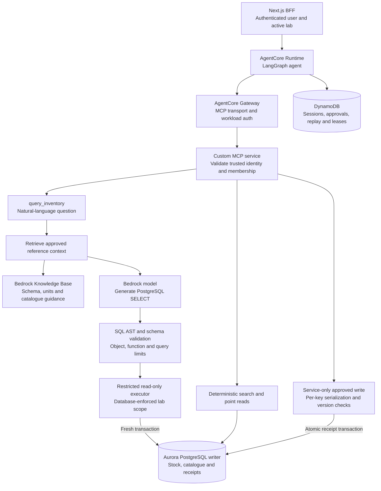
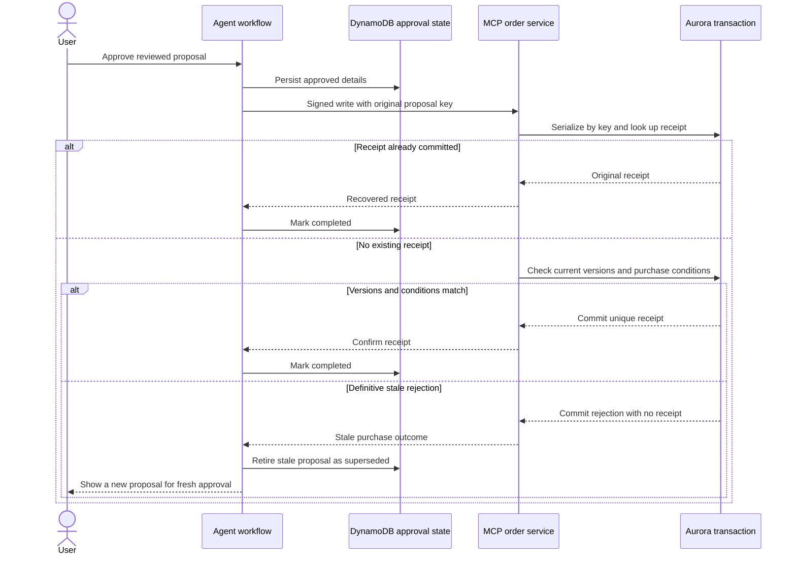

# Proposed AgentCore real-time inventory and RAG design

**Status:** Proposed; not implemented, deployed or benchmarked.  
**Decisions agreed:** October 14, 2026.  
**Scope:** Extend the [AgentCore proposal](../../AGENTCORE.md) with lab-scoped live inventory analysis, retrieved reference context and purchase-time revalidation.  
**Current implementation:** See [local architecture](Bench-System-Design.md), [database design](../database-design.md) and [application skills](../skills.md).

## Agreed requirements

| Decision            | Selected behavior                                                                                                                                       |
| ------------------- | ------------------------------------------------------------------------------------------------------------------------------------------------------- |
| Knowledge-base role | Retrieve schema, catalogue descriptions and policy guidance for analysis. Current stock/price come from the operational database.                       |
| Freshness           | Each request reads current committed data when database execution begins. Generation/execution may take seconds; no continuously updating subscription. |
| Stock ownership     | Inventory is scoped to an authorized lab. Approved catalogue is shared; orders and personal memory remain user-private.                                 |
| SQL generation      | Bedrock model plus RAG context, with application validation before direct Aurora execution.                                                             |
| Purchase safety     | Authoritative point reads before proposing; atomic source-version checks when committing a new receipt. Changes require a new proposal and approval.    |
| Deployment scope    | Documentation only. No AWS services, schema migrations or application-code changes are included.                                                        |

The earlier five-minute reporting-copy option was rejected. The specific Bedrock `GenerateQuery` approach was revised when real-time requirements were clarified: the selected path is custom PostgreSQL generation/execution, not native structured-KB access to Aurora.

## Architecture and trust boundaries



The model receives no database credentials or unrestricted SQL-execution tool. `query_inventory` accepts a question; SQL generation and execution happen behind the custom MCP boundary. Existing search/read tools remain available for exact product resolution. Only the deterministic service-owned write path can create a purchase receipt.

Bedrock model access is new cloud adapter work. SQL generation is a bounded model call inside the tool adapter; orchestration remains one LangGraph agent. The local runtime currently supports demo, OpenAI and Ollama and has no deployed `query_inventory` tool.

## Knowledge context versus operational facts

| Reference context in the KB                                 | Live data in Aurora                                               |
| ----------------------------------------------------------- | ----------------------------------------------------------------- |
| Approved schema descriptions and relationship guidance.     | Lab-specific stock and monotonically increasing stock versions.   |
| Pack-unit meanings, SKU aliases and catalogue descriptions. | Current SKU, supplier eligibility, prices and catalogue versions. |
| Guidance for expressing valid inventory questions.          | Active lab membership and order receipts.                         |
| Curated examples with document/schema version identifiers.  | Commit-time conditions used by the ordering service.              |

Reference context can lag without becoming an authority for numerical stock. Match retrieved schema context to a versioned approved schema. Reject incompatible generation rather than guessing a new column or falling back to a KB stock summary. Retrieval absence or failure must produce an explicit inability to answer unless the service has a maintained, approved static context fallback.

The application should cite context sources for definitions and guidance, and label stock/price answers as database results with read timestamps. A document citation is not evidence that a stock count is current.

### Why this is not the native structured-KB SQL path

AWS documents structured Knowledge Bases using Redshift as the query engine with Redshift or Glue/Lake Formation stores. `GenerateQuery` produces SQL; structured `Retrieve` executes a query, while `RetrieveAndGenerate` synthesizes an answer from its results. Those capabilities do not document direct native Aurora access. [Supported structured stores](https://docs.aws.amazon.com/bedrock/latest/userguide/knowledge-base-prereq-structured.html), [query API behavior](https://docs.aws.amazon.com/bedrock/latest/userguide/knowledge-base-generate-query.html)

In the selected design, a Bedrock model generates PostgreSQL from retrieved context and the application's executor queries Aurora. This is a custom model/tool integration. It does not call `GenerateQuery` and then assume its Redshift SQL will run unchanged on Aurora.

AWS now documents a native AgentCore Gateway connector specifically for Managed Knowledge Bases. That connector does not establish native structured-SQL-KB support. The primary design retains its custom MCP analysis adapter; a managed document-context connector could be evaluated separately without giving it operational database authority. [Managed-KB connector scope](https://docs.aws.amazon.com/bedrock-agentcore/latest/devguide/gateway-target-connector-managed-kb.html)

## Real-time read semantics

Connect the restricted analysis executor to the Aurora **writer endpoint** and start a fresh, short read-only transaction after SQL validation. Define a snapshot at the database read boundary; later commits appear on the next request. Do not reuse an old transaction or serve cached numerical answers as current.

AWS documents that the writer endpoint reaches the current primary and also supports reads. Its Aurora guidance recommends the cluster endpoint for read-after-write consistency because replicas can lag. Endpoint failover/reconnection and transaction isolation still require testing with the selected driver. [Writer endpoint](https://docs.aws.amazon.com/AmazonRDS/latest/AuroraUserGuide/Aurora.Endpoints.Cluster.html), [consistency guidance](https://docs.aws.amazon.com/AmazonRDS/latest/AuroraUserGuide/aurora-poc.html)

Return database-read start/end timestamps and identify the source. These describe when the read occurred; they are not a promise that the screen remains current after the answer. Use one statement snapshot, or an explicitly shared snapshot if a future report needs several statements.

If the writer is unavailable, the service fails the real-time request. A replica or old KB answer cannot silently satisfy this freshness contract. Query latency and writer load are separate performance constraints to measure. Seconds of response time are acceptable, but no measured latency SLO is claimed.

## Proposed analysis tool and execution pipeline

Model-visible input:

```json
{ "question": "Which approved supplies are out of stock in my lab?" }
```

The service injects verified user and active-lab identity separately. Model arguments cannot select a database, connection identity, schema, arbitrary lab or raw SQL to execute.

The tool performs the following bounded workflow:

1. Authenticate the trusted caller context and verify current lab membership.
2. Retrieve approved schema/catalogue context and record its source/version identifiers.
3. Ask the Bedrock model for a single PostgreSQL read query over allowed inventory/catalogue objects.
4. Parse its SQL AST. Check the entire statement, including nested queries, CTEs, referenced objects and functions. Reject writes, DDL, multiple statements, unsafe functions, role/session changes and unapproved relations. Checking a leading `SELECT` string is insufficient.
5. Enforce row, byte, execution-time and overall request limits. Use bounded concurrency to protect the writer. Start the authorized read-only transaction and execute the validated query.
6. Return typed rows, read timestamps, source/context identifiers and a truncation flag. Let the orchestration model explain only the returned evidence.

Database permissions and isolation remain authoritative even after SQL validation. SQL validity does not prove semantic correctness: wrong joins, units or aggregation can still answer the wrong question. Evaluate those separately. Aggregate counts must be computed by SQL, not inferred from a truncated list. Do not sum different pack units into an unexplained total.

Proposed response fields, not an implemented API contract:

```ts
{
  rows: Array<Record<string, string | number | boolean | null>>;
  labId: string;
  source: 'aurora-writer';
  readStartedAt: string;
  readCompletedAt: string;
  schemaVersion: string;
  contextSources: Array<{ uri: string; version: string }>;
  truncated: boolean;
  traceId: string;
}
```

Concrete time/row/byte limits, model selection and connection-pool sizing are deployment configuration to establish through workload tests. The current 1.2-second local mock timeout is not a validated budget for cloud retrieval plus SQL generation.

## Lab isolation

Use a stable `labId` and authoritative membership, distinct from the user's saved lab display/delivery preference. Validate the active lab server-side for every analysis, proposal and write. The model cannot authorize lab access by including a `WHERE lab_id = ...` predicate.

The analysis role has access only to approved inventory/catalogue objects, not approval ledgers, personal memory or other users' order receipts. Enforce inventory scope through PostgreSQL row-level security or equivalently isolated database access. Keep shared catalogue permissions separate. The query role must not own protected tables or have a bypass capability.

For pooled connections, the service establishes tenant context inside the request transaction and reliably clears it before reuse. Generated SQL cannot change that context. Test actual role, view and pooling semantics, including missing context and hostile attempts to select another lab. AWS recommends PostgreSQL RLS for pooled tenant isolation, but correct policy/role configuration remains application deployment work. [AWS PostgreSQL tenant-isolation guidance](https://docs.aws.amazon.com/prescriptive-guidance/latest/saas-multitenant-managed-postgresql/best-practices.html)

Keep order-history reads user-private even when several people belong to the same lab. Workload IAM authentication alone does not derive the correct business user/lab. The custom MCP service needs verified identity propagation from the BFF/Runtime and must reject missing or tampered scope.

## Data ownership and proposed schema additions

| Store             | Proposed responsibilities                                                                                                                            |
| ----------------- | ---------------------------------------------------------------------------------------------------------------------------------------------------- |
| Aurora PostgreSQL | `labs`, authoritative membership, shared `catalogue_items`, lab-keyed `inventory`, serialized purchase-operation outcomes and unique order receipts. |
| DynamoDB          | User/session history, explicit preferences, immutable proposals, approvals, HTTP replay and conditional leases.                                      |
| Bedrock KB        | Curated reference documents and schema/catalogue context.                                                                                            |
| AgentCore Memory  | Conversational events with trusted actor/session scope and explicit retention.                                                                       |

These are logical responsibilities, not deployed DDL. Inventory needs a key containing lab and SKU plus a stock version. Catalogue records need a version covering price and eligibility. Receipts need a unique proposal key and immutable owner/lab/purchase binding. An operation record or equivalent locking scheme serializes concurrent attempts for the same proposal.

Cloud proposals must add requested quantity, stable lab ID and expected stock/catalogue versions to the current immutable details. The signing/verification contract must bind those fields. The current local `Proposal` and proof types do not contain these cloud additions.

## Proposal, approval and atomic ordering

Analysis helps answer questions. To propose purchasing, the agent still obtains authoritative item/stock/eligibility data through deterministic MCP reads and computes the shortfall from the explicit requested pack quantity.

After review, the service persists approval before sending the privileged write. The order service uses the original proposal key and a transaction that:

1. Authenticates ownership and lab membership and verifies the signed immutable purchase details.
2. Serializes attempts for that proposal key. If a matching receipt already exists, returns it before comparing stock versions again. An existing terminal stale rejection is returned as the same definitive no-order outcome rather than reopening that operation.
3. Acquires `SELECT ... FOR UPDATE` locks on the relevant inventory/catalogue rows and holds them through receipt/outcome commit. Under those locks, it compares expected versions, current stock-derived shortfall, price and eligibility. Missing required rows fail closed.
4. On a mismatch, records a definitive stale outcome with no order receipt. Otherwise inserts the unique receipt and commits the purchase-operation outcome atomically.

All relevant stock/catalogue updaters must maintain their versions. Take locks in a consistent order and handle deadlock/transaction-abort retries with rollback and the original proposal key. A version-filtered ordinary `SELECT` followed by receipt insertion would leave an intervening-update race; the row locks must remain held through commit. PostgreSQL documents `FOR UPDATE` as blocking conflicting row changes until the transaction ends. The analytic read-only role cannot invoke this write path. [PostgreSQL row locking](https://www.postgresql.org/docs/current/explicit-locking.html)



The new proposal requires fresh authoritative reads; it can ask for clarification or conclude that no purchase is needed if stock now covers the request. A proposed cloud `superseded` outcome distinguishes this from a user decline. It is not a status in the current local implementation.

Aurora receipt creation and DynamoDB workflow updates remain separate commits. A lost response is an **unknown outcome**, not proof of staleness. Keep the approval recoverable and resolve the original operation key first. Only a definitive no-order rejection permits replacing its proposal. If a receipt committed, return it even if stock later changed.

This transaction creates the application's purchase record; it does not atomically place an order in an external supplier system. A real supplier requires an idempotent integration or outbox/reconciliation design. Deduplication covers retries of the same proposal; independently approved proposals for the same SKU remain separate purchases. Cross-proposal replenishment coordination is outside this selected design.

## Failure behavior and observability

| Failure                                     | Proposed behavior                                                                                            |
| ------------------------------------------- | ------------------------------------------------------------------------------------------------------------ |
| Context missing or schema versions disagree | Ask for clarification or return an explicit context/schema error; do not invent columns.                     |
| Generated SQL rejected                      | Do not execute it. Surface a safe failure and trace validation category.                                     |
| Lab context missing or unauthorized         | Deny the operation; never broaden to shared stock.                                                           |
| Writer timeout/failover                     | Abort or reconcile the request appropriately; do not claim a cached count is real-time.                      |
| Result limit exceeded                       | Return an explicit truncation indicator or bounded-query failure. Never infer full totals from partial rows. |
| Purchase snapshot changed                   | Obtain a definitive no-order outcome, retire the stale proposal and seek fresh review.                       |
| Purchase response lost                      | Reconcile the original key before deciding whether a new proposal is allowed.                                |

Link Runtime, Gateway, MCP, KB, model, SQL and order spans by request trace ID. Record trusted scope identifiers, context/schema versions, SQL fingerprint, validation result, read timestamps, latency, usage, row counts, truncation, expected versions and receipt/operation IDs. Restrict access to raw prompts, rows or SQL literals that can contain private data. New SQL/KB spans and metrics are future work, not current JSONL fields.

## Alternatives and feasibility boundaries

| Alternative                               | Reason it is not the selected primary path                                                                                                                            |
| ----------------------------------------- | --------------------------------------------------------------------------------------------------------------------------------------------------------------------- |
| Five-minute Redshift reporting copy       | Rejected because analysis must read current operational data per request.                                                                                             |
| Native structured KB with `GenerateQuery` | Its documented query-engine path is Redshift; it is not a direct Aurora SQL connector.                                                                                |
| Redshift federation into live Aurora      | Redshift documents live federated reads, but structured-KB metadata discovery and generation for those objects need an end-to-end proof. It adds another query layer. |
| Cached/vectorized stock answers           | Reference retrieval cannot establish current stock for the agreed freshness contract.                                                                                 |
| Generated SQL that can write orders       | Purchase authorization and receipt recovery belong to the deterministic approved-write service.                                                                       |

Redshift federation is a real capability: AWS documents live operational PostgreSQL/MySQL queries and transaction-snapshot behavior. It could be reconsidered if using `GenerateQuery` becomes mandatory, after proving KB discovery, generated SQL, isolation and controlled-commit visibility together. No such integration test has been performed. [Federation overview](https://docs.aws.amazon.com/redshift/latest/dg/federated-overview.html), [snapshot and federation limitations](https://docs.aws.amazon.com/redshift/latest/dg/federated-limitations.html)

## Verification gates before deployment

- **Freshness:** commit a stock change, then issue a new analysis and verify the changed value; show that a change after a snapshot appears on the next request.
- **Isolation:** attempt cross-lab queries, missing scope, role/context changes, connection reuse and reads of another user's orders. Include actual database roles and views.
- **SQL correctness:** evaluate approved joins, numeric comparisons, pack units, aggregations, ambiguity, empty results, truncation and adversarial SQL/context text. A valid query can still be semantically wrong.
- **Purchase safety:** change stock, price or eligibility while approval is pending; require a new review after a definitive rejection. Race duplicate writes and lose a committed receipt response; retain one receipt under the original key.
- **Split-store recovery:** kill the agent after Aurora commit but before DynamoDB completion, then recover by proposal key. Prove that an uncertain result cannot be superseded into another purchase.
- **Operations:** verify private networking, authentication propagation, writer connections/failover, pool isolation, limits, quotas, regional availability, data-processing geography, model access, secrets, backups and cost under representative load.
- **Evidence:** run live Bedrock and database tests separately from the local deterministic suite. No local evaluation establishes any of these cloud guarantees.

No prototype, provider benchmark or AWS deployment was performed for this proposal. The implementation would need cloud adapters, migrations, membership authorization, source versions, query validation and new evaluations before these behaviors could be claimed.
