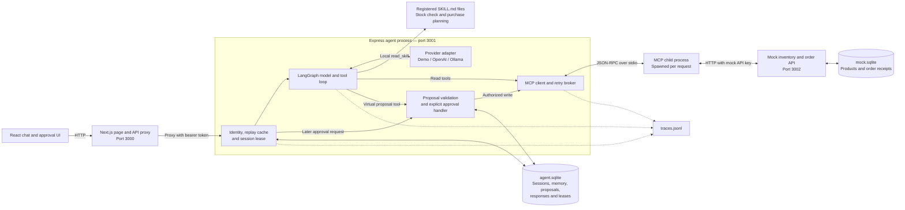
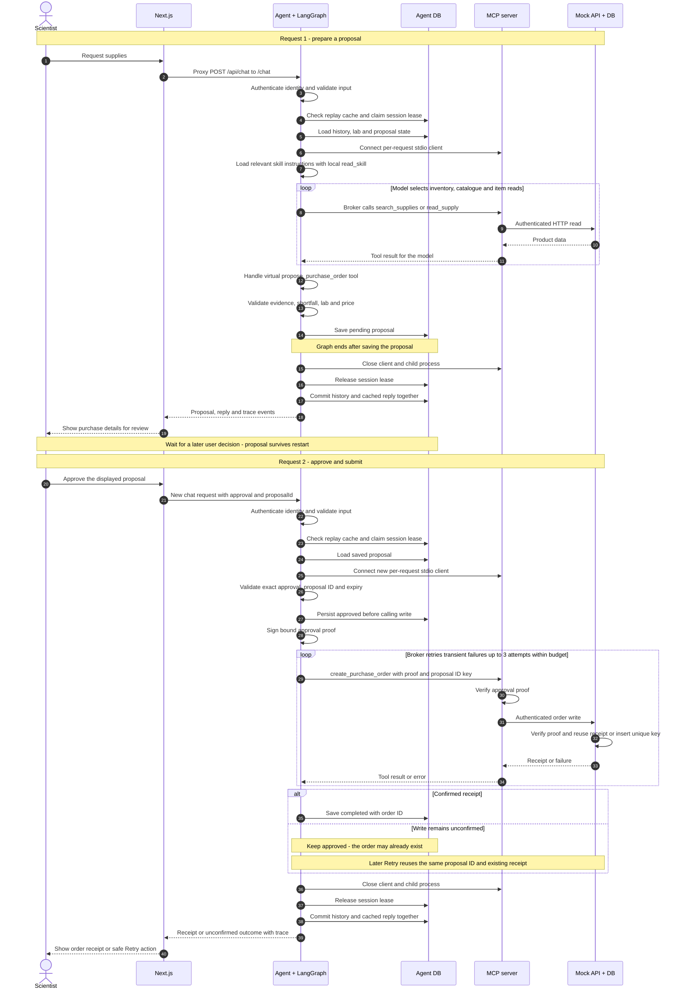
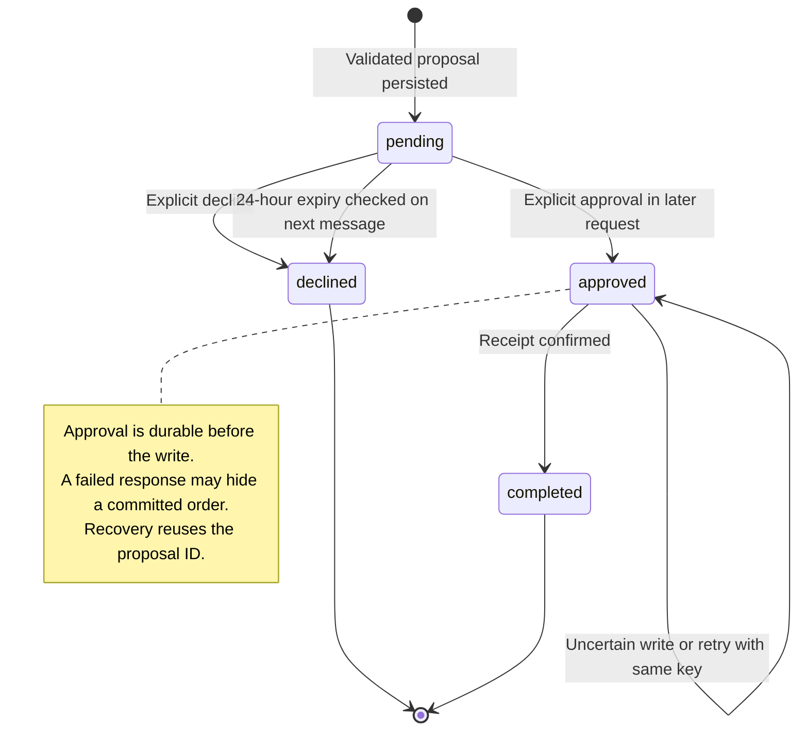

# Bench — Application Architecture

**Status:** Implemented locally  
**Last updated:** October 14, 2026  
**Scope:** Current services, data ownership, request flow and approval recovery  
**Related documents:** [documentation index](../README.md), [domain glossary](../../GLOSSARY.md), [proposed AgentCore deployment](../../AGENTCORE.md)

## 1. Abstract

Bench checks lab supplies and prepares a purchase proposal through an authenticated MCP boundary. A scientist reviews the item, shortfall quantity, supplier, price and lab. The service creates the order only after explicit approval in a later HTTP request.

The application runs locally with Next.js, an Express agent service, per-request MCP child processes and a mock ordering API. SQLite preserves user context and approvals across restarts. The default provider is a deterministic test double. OpenAI and Ollama adapters are implemented; live model evaluations have not been run.

## 2. Goals and non-goals

| Goals                                                                      | Non-goals                                                              |
| -------------------------------------------------------------------------- | ---------------------------------------------------------------------- |
| Check approved inventory and catalogue through MCP.                        | Connect to real suppliers or make purchasing commitments.              |
| Require human approval before an idempotent order write.                   | Allow unattended or model-authorized purchasing.                       |
| Preserve conversation, lab memory and approval state.                      | Support multi-item carts or reserve inventory.                         |
| Demonstrate retries, injected failures, traces and repeatable evaluations. | Provide production identity, distributed scaling or an AWS deployment. |

## 3. Background and problem statement

The assignment requires an agent that reads inventory, searches approved suppliers and performs a purchase-order write. The key reliability problems are preserving a human decision through service restarts and recovering from a lost write response without creating another order.

Application code owns authorization, proposal validation and durable state. The model selects read tools and can propose a purchase; the service owns the privileged write. Inventory and catalogue searches currently use the same seeded approved product table.

## 4. Current architecture

The model adapter runs in the agent process. OpenAI and Ollama modes make outbound HTTP calls; demo mode runs locally. MCP has no listening network port.

| Component                  | Responsibility                                                                      | Source                                                                             |
| -------------------------- | ----------------------------------------------------------------------------------- | ---------------------------------------------------------------------------------- |
| Next.js UI                 | Chat, proposal review, approval controls and latest trace display.                  | [app/page.tsx](../../app/page.tsx)                                                 |
| Next.js API proxy          | Forward allowlisted endpoints, authorization and errors to the agent.               | [API route](../../app/api/[...path]/route.ts)                                      |
| Agent HTTP service         | Validate identity and input, load state and coordinate a request.                   | [server/index.ts](../../server/index.ts)                                           |
| LangGraph orchestration    | Loop between model decisions and tools within a bounded request.                    | [server/agent.ts](../../server/agent.ts)                                           |
| Provider adapter           | Select demo, OpenAI or Ollama through configuration.                                | [server/model.ts](../../server/model.ts)                                           |
| Application skills         | Discover workflow descriptions and load registered Markdown instructions on demand. | [server/skills.ts](../../server/skills.ts), [skills](../../skills)                 |
| Tool broker and MCP server | Discover tools, retry transient errors and validate backend access.                 | [server/tools.ts](../../server/tools.ts), [server/mcp.ts](../../server/mcp.ts)     |
| Mock backend               | Serve approved products, inject failures and deduplicate order writes.              | [server/mock.ts](../../server/mock.ts)                                             |
| State and approval helpers | Persist workflow state and sign approval proofs.                                    | [server/db.ts](../../server/db.ts), [server/approval.ts](../../server/approval.ts) |
| Trace recorder             | Record model, tool, approval, request and memory events.                            | [server/trace.ts](../../server/trace.ts)                                           |

## 5. Request lifecycle

This diagram follows the successful proposal and approval path, with the unconfirmed-write recovery branch. Cached requests return early, invalid or stale approvals cannot write, and a decline closes the pending proposal without creating an order. The retry loop stops as soon as a receipt is confirmed or a non-retryable error occurs. Read tools use the same bounded retry broker.

Before accepting a proposal, the service requires inventory and catalogue search evidence plus an authoritative item read in the current request. It validates an approved item, a saved lab, a whole purchase quantity from 1 to 100 and a total no greater than $5,000. The quantity must equal the explicit requested quantity minus current stock.

For example, a request for five boxes of tips with two boxes in stock produces a proposal for three boxes. The proposal contains one item. There is no stock reservation or inventory consumption.

The model sees `search_supplies`, `read_supply`, the local `read_skill` tool and the virtual `propose_purchase_order` tool. Its prompt asks it to discover skill descriptions and load the relevant registered Markdown bodies into its tool conversation. This is guidance rather than a service-enforced prerequisite. Stock checks use [stock-check](../../skills/stock-check/SKILL.md); purchases also use [purchase-planning](../../skills/purchase-planning/SKILL.md). Skill instructions guide the workflow while application code enforces policy. `create_purchase_order` is called by the service's approval handler outside the graph.

## 6. API and data contracts

The browser uses `/api/*` endpoints on Next.js; the proxy forwards them to the agent service. Chat takes a user ID, session ID and message, with optional HTTP request ID and reviewed-proposal ID. Its response contains a reply, active proposal or null, optional confirmed order, trace ID and events.

The [HTTP API guide](../api.md) owns endpoint schemas, record fields, examples and status behavior. Handled operational failures can return HTTP 200 with an explanatory reply; a 200 alone does not confirm a purchase. The [MCP guide](../mcp-tools.md) owns tool schemas, pagination and internal backend error contracts.

The authenticated user scopes session and lab access. The HTTP request ID identifies transport replay; the immutable proposal ID identifies the business write. These are separate identities with different recovery behavior.

## 7. Consistency, idempotency and replay

The persisted statuses are exactly `pending`, `approved`, `completed` and `declined`. Expiration transitions a pending proposal to `declined`; an unconfirmed write remains `approved`.

| Store          | Tables or contents                                       | Ownership and constraints                                                                                                                     |
| -------------- | -------------------------------------------------------- | --------------------------------------------------------------------------------------------------------------------------------------------- |
| `agent.sqlite` | `sessions`, `memory`, `proposals`, `responses`, `leases` | Conversation keyed by user and session; lab memory keyed by user. A partial unique index allows one pending or approved proposal per session. |
| `mock.sqlite`  | `products`, `orders`                                     | Approved product data and durable receipts. `orders.idempotency_key` is unique.                                                               |
| `traces.jsonl` | Structured request events                                | Local diagnostic record; separate from transactional state.                                                                                   |

SQLite uses WAL and a busy timeout. Several records store JSON payloads. There is no distributed transaction between agent state and order receipts. The [database guide](../database-design.md) owns the physical schema and commit boundaries.

| Scenario                                   | Recovery behavior                                                                                                     |
| ------------------------------------------ | --------------------------------------------------------------------------------------------------------------------- |
| Agent restarts while awaiting approval     | Load the persisted pending proposal on the next request.                                                              |
| Order commits but its response is lost     | Retry the same proposal key; the mock returns the original receipt.                                                   |
| All write attempts fail                    | Keep `approved`, disclose the uncertain outcome and allow safe retry. An uncertain approved write cannot be declined. |
| Same HTTP request is replayed              | Return the cached reply; reject changed input under the same request ID.                                              |
| Concurrent requests target one session     | A durable session lease rejects overlapping work. A crashed request's lease expires.                                  |
| Product price differs from signed approval | Reject a new write. Automatic re-proposal after this failure is not implemented.                                      |

The lease supports this local runtime; it does not provide distributed fencing. The current handler closes MCP and releases the lease before the final history/response transaction. LangGraph has no persistent checkpointer: the graph ends at the proposal, and the next HTTP request resumes the application workflow from SQLite.

## 8. Security and privacy considerations

Bearer tokens map to configured demo users. The API rejects a mismatched user ID and injects user scope into order-history calls. Demo identity is intended for local evaluation.

The agent signs a ten-minute HMAC-SHA256 proof over the approved proposal and purchase details. MCP verifies signature and expiry. The mock verifies them again, compares purchase arguments with the claims, and checks current eligibility and price before a new receipt. MCP authenticates to the mock with its backend key; the proof is internal and not exposed to the model.

Trace data contains conversation and lab details. JSONL serialization redacts matching object keys, while the broker separately masks proof arguments in its events. This does not scrub arbitrary secrets embedded in text or apply blanket redaction to all in-memory UI events. See [security and privacy](../security.md) for the exact trust and redaction boundaries.

Conversation and memory have lazy retention policies. Pending proposals expire on a later chat; approved uncertain purchases remain recoverable. Response-cache cleanup keeps the newest 10,000 rows before processing the next uncached chat, and a subsequent insert can temporarily exceed that count. See [database retention](../database-design.md#retention) for all policies.

## 9. Operational readiness

The [operations guide](../operations.md) owns setup, environment settings, process lifecycle, diagnostics and container handling. The local launcher runs Next.js, the agent and the mock together; MCP is a per-request stdio child.

The tool broker uses bounded retries with backoff, jitter and retry-after handling. Request and backend-attempt settings are budgets rather than measured end-to-end SLOs, and not all connection/close operations are explicitly covered by them.

The [testing guide](../testing.md) records verification scope and links to the latest executed evidence. Deterministic tests cover skill loading, approval/restart, isolation, pagination, failures and write deduplication. Live-model selection and Docker runtime verification remain pending. Earlier browser screenshots predate the skills feature.

## 10. Alternatives and tradeoffs

| Decision                              | Benefit                                                                                      | Tradeoff                                                                            |
| ------------------------------------- | -------------------------------------------------------------------------------------------- | ----------------------------------------------------------------------------------- |
| Next.js plus a separate agent service | Keeps the agent lifecycle separate from UI reloads and provides a portable service boundary. | Additional process and HTTP proxy.                                                  |
| Durable approval in SQLite            | Preserves decisions and supports recovery after restart.                                     | Persistence and state-transition logic to maintain.                                 |
| Service-owned purchase write          | Enforces approval independently of model behavior.                                           | Write orchestration sits outside the ordinary model tool loop.                      |
| Per-request stdio MCP process         | Gives each request a clear tool lifecycle and keeps the mock behind MCP.                     | Process startup overhead.                                                           |
| Local SQLite and mock receipts        | Makes evaluation repeatable with no cloud setup.                                             | Shared storage and distributed coordination would be needed for horizontal scaling. |

## 11. Open questions

- Which configured provider and model should be used for the live acceptance run?
- What production identity, purchasing roles and secret rotation policy are required?
- Should production ordering reserve inventory or recheck the shortfall at approval time?
- Which shared database, retention policy and distributed coordination rules should replace local SQLite for AWS?

## 12. Decision and next steps

Retain the current local boundaries for the assignment: Next.js handles the page and proxy, LangGraph selects read tools, and the service owns durable approval and write recovery. Complete live-model evaluation and Docker runtime verification before submission.

The [AgentCore document](../../AGENTCORE.md) describes a proposed cloud deployment. AWS services are not part of the current implemented runtime.
