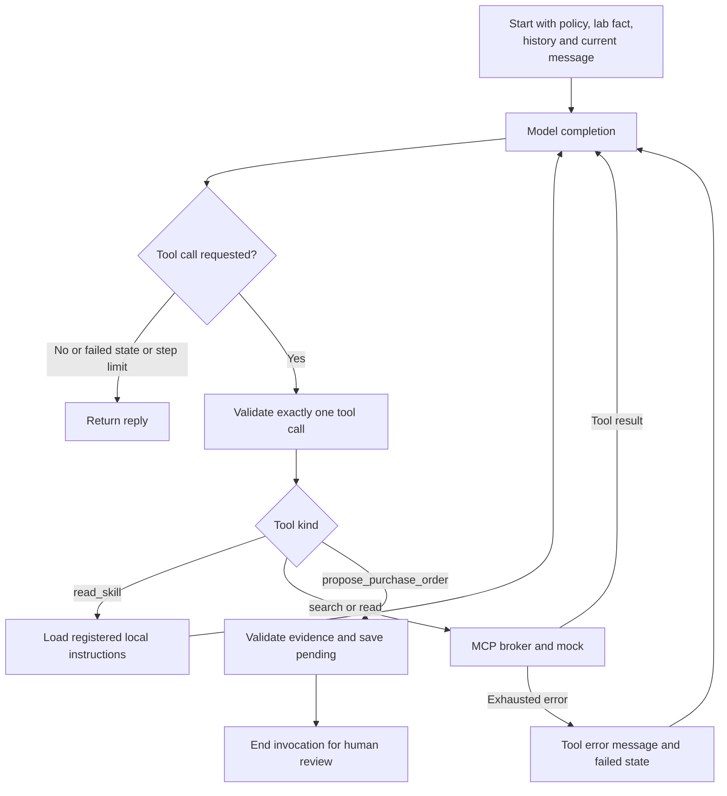

# Backend design

The backend separates request authorization, model-guided reads, durable purchase decisions and mock ordering. Next.js supplies the web proxy; Express and LangGraph own the agent workflow.

Sources: [HTTP service](../server/index.ts), [orchestrator](../server/agent.ts), [model adapter](../server/model.ts), [tool broker](../server/tools.ts), [approval helpers](../server/approval.ts).

## Module responsibilities

| Module             | Responsibility                                                                                |
| ------------------ | --------------------------------------------------------------------------------------------- |
| `server/index.ts`  | Express JSON/auth middleware, chat/session/orders/fault routes and liveness.                  |
| `server/agent.ts`  | Request replay, lease, lab updates, proposal decisions, graph and final response persistence. |
| `server/model.ts`  | Shared completion interface and demo/OpenAI/Ollama protocol adaptation.                       |
| `server/skills.ts` | Registered Markdown skill catalog and local instruction reads.                                |
| `server/tools.ts`  | Per-request MCP client, error normalization, bounded retries and tool traces.                 |
| `server/mcp.ts`    | MCP schema registrations, proof gate and authenticated mock HTTP adapter.                     |
| `server/mock.ts`   | Product search/read, order receipts, unique write key and fault injection.                    |
| `server/db.ts`     | Agent SQLite tables, lab/history/proposal/cache/lease operations.                             |
| `server/trace.ts`  | Request-scoped events and synchronous JSONL append.                                           |
| `server/config.ts` | Environment validation and derived paths/identities.                                          |
| `server/seed.ts`   | Local product fixtures.                                                                       |

## Request coordinator

After Express validates authentication and input, `handleMessage` follows this order:

1. Create a trace and check the response cache for the user/session/request ID and normalized input. Return a cached reply immediately, or reject conflicting input.
2. Claim the durable session lease and set the request deadline.
3. Run lazy retention cleanup. Save an explicitly declared `My lab is …` preference when present.
4. Load the active proposal and check pending expiry. Connect the per-request MCP client.
5. If a proposal exists, process its decision without invoking the graph. Otherwise handle a decision with no active proposal or invoke the graph for an ordinary message.
6. Close MCP and release the lease in `finally`.
7. Append the completed request event, then commit user/assistant history and the response-cache entry together.

Operational exceptions inside the workflow usually become an honest reply with the active proposal preserved. Cache/lease errors and failures outside that catch can reach Express as HTTP errors. See the [API guide](api.md#status-codes-and-errors).

The final history transaction follows lease release in the current implementation. Do not infer a stronger distributed atomicity or fencing guarantee from the presence of a lease.

## LangGraph execution

There are two graph nodes, `model` and `tools`. The graph requires one tool call at a time, allows up to 12 model steps and uses recursion limit 30. A failed tool/proposal/skill operation is added as a tool error; the next completion receives no tools and the service supplies an honest failure fallback. A multi-tool response violates the single-call policy and reaches outer request-error handling.

The system prompt contains policy, a skill metadata catalog and the user-scoped saved lab fact. The model sees only two MCP reads plus local `read_skill` and virtual `propose_purchase_order`. It cannot call the real order write or fault tools. Skill use is requested in the prompt, not enforced as a prerequisite by the tool handler.

Each graph invocation gets saved user/assistant history plus its current internal model/tool messages. Internal tool conversations last only for that invocation. The graph ends after saving a proposal. There is no persistent LangGraph checkpointer; the next HTTP request resumes the business workflow from SQLite.

## Proposal validation

The virtual proposal tool accepts `{itemId, quantity, lab}`. Before saving, service code requires:

- The exact item ID appeared in inventory search, catalogue search and an authoritative item read during this invocation.
- The item is approved, the quantity is an integer from 1 to 100 and total cost is at most 500,000 cents.
- The supplied lab matches the user's explicitly saved lab.
- An explicit numeric requested quantity can be extracted from the **current message**; purchase quantity equals `max(0, requested quantity - stock)`.

The quantity extractor supports certain whole-pack phrases and `need/order/buy/purchase <number>` forms. It is not a general unit parser. Conversation context can resolve an earlier item, but it does not replace the current-message quantity check.

Validation success creates an immutable proposal ID and exact purchase details, stores `pending` with a 24-hour expiry, and returns a review prompt. It does not create an order. Pack quantities and domain records are defined in the [glossary](../GLOSSARY.md).

## Approval and recovery

Supported decisions and stale-proposal checks are documented in the [API guide](api.md#approval-and-replay-rules). They run outside the graph.

For an approval or recovery, the service saves `approved` first, then signs a fresh ten-minute HMAC proof and calls `create_purchase_order`. The proposal ID is reused as the business-write key on every automatic retry and later recovery request.

A confirmed receipt changes the proposal to `completed` with its order ID. An exhausted or rejected write leaves it `approved` and tells the user the order may already exist. A later `retry` attempts reconciliation under the same key. That state cannot be declined.

The generic unconfirmed handling also covers permanent write rejection. For example, a changed price can leave an approved proposal that retries cannot complete; automatic reset and re-proposal are not implemented. The message asking for Retry is therefore not a guarantee that every permanent rejection can recover automatically.

The mock's unique receipt key is the durable deduplication mechanism. There is no distributed transaction between the agent and mock. See [database commit boundaries](database-design.md#commit-boundaries-and-recovery).

## Model adapters

| Mode     | Implementation                                                                                                                                      | Limits                                                                             |
| -------- | --------------------------------------------------------------------------------------------------------------------------------------------------- | ---------------------------------------------------------------------------------- |
| `demo`   | Deterministic TypeScript fixture consuming real tool results and making repeatable tool/skill choices.                                              | Not a language model or evidence of language understanding.                        |
| `openai` | Chat Completions HTTP request with function definitions, configured model and bearer key. Sets `parallel_tool_calls: false` when tools are present. | Real-provider behavior not exercised by the recorded demo evaluations.             |
| `ollama` | Non-streaming `/api/chat`, configured URL/model. Converts argument strings to objects on send and back to strings on receive.                       | Requires a running compatible tool-capable local model; live verification pending. |

The adapter applies the remaining deadline to model HTTP calls and traces exceptions. It does not implement model-provider retries. Provider names and model settings are selected through [configuration](operations.md#configuration-reference).

OpenAI usage is recorded when supplied, otherwise null. Demo tokens are null. Ollama maps its evaluation counts and currently substitutes zero for missing counts; those zeros should not be interpreted as measured free inference.

## Boundaries and extension points

Update local procedural knowledge through [application skills](skills.md). Add backend capabilities through MCP, then deliberately decide which schemas the model may see. Keep policy checks in service/backend code even when a skill explains the same workflow.

Changing persistence, adding parallel workers or integrating a real supplier requires revisiting [database constraints](database-design.md) and [purchase authorization](security.md#purchase-authorization). The existing agent is single-machine, single-item, non-streaming and does not reserve stock.
