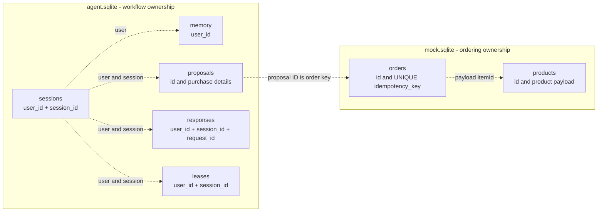

# Database design

Bench uses two local SQLite files under `DATA_DIR`, plus a JSONL trace file. This guide describes the physical schema and its application-level guarantees. Domain terminology is defined in the [glossary](../GLOSSARY.md).

Sources: [agent persistence](../server/db.ts), [mock persistence](../server/mock.ts), [JSON interfaces](../server/types.ts), [request orchestration](../server/agent.ts).

## Ownership and logical references



Dashed arrows are logical references. There are **no declared foreign keys**, joins across databases or cascading deletions. For example, a proposal can survive deletion of old conversation history. Users are configured identities; there is no `users` table.

Both databases enable `journal_mode=WAL` and `busy_timeout=5000`. The application uses synchronous `node:sqlite` access. Schema creation uses `CREATE TABLE IF NOT EXISTS`; there is no migration runner or schema-version table.

## Agent database

| Table       | Columns                                                                                        | Physical constraints                                       |
| ----------- | ---------------------------------------------------------------------------------------------- | ---------------------------------------------------------- |
| `sessions`  | `user_id TEXT`, `session_id TEXT`, `messages TEXT NOT NULL DEFAULT '[]'`, `updated_at INTEGER` | Composite primary key `(user_id, session_id)`.             |
| `memory`    | `user_id TEXT`, `lab TEXT NOT NULL`, `updated_at INTEGER NOT NULL`                             | Primary key `user_id`.                                     |
| `proposals` | `id TEXT`, `user_id TEXT`, `session_id TEXT`, `status TEXT`, `payload TEXT NOT NULL`           | Primary key `id`; partial unique index described below.    |
| `responses` | `user_id TEXT`, `session_id TEXT`, `request_id TEXT`, `input TEXT`, `response TEXT`            | Composite primary key `(user_id, session_id, request_id)`. |
| `leases`    | `user_id TEXT`, `session_id TEXT`, `owner TEXT`, `until INTEGER`                               | Composite primary key `(user_id, session_id)`.             |

The schema does not declare `NOT NULL` on every identity or timestamp column. Required identity, status and purchase values are supplied and validated by application code. There are no SQL `CHECK` constraints for statuses or JSON validity.

The active-proposal constraint is:

```sql
CREATE UNIQUE INDEX one_active_proposal
ON proposals(user_id, session_id)
WHERE status IN ('pending', 'approved');
```

It permits at most one active proposal per user/session pair. Completed and declined proposals remain stored.

### JSON payloads

- `sessions.messages`: serialized user/assistant `ChatMessage[]`, limited to the last 40 messages at save time. Internal model/tool messages are not persisted as conversation history.
- `proposals.payload`: full `Proposal`, including IDs, owner, session, item, supplier, quantity, unit, prices, lab, status, creation/expiry timestamps and optional order ID. The separate `status` column supports active lookup and uniqueness.
- `responses.input`: serialization of normalized `message` and optional `proposalId`. It detects changed input under a reused HTTP request ID.
- `responses.response`: full `AgentReply`, including the reply, proposal, optional receipt and latest trace events.

Numeric timestamps are Unix milliseconds. Money is integer USD cents. The [HTTP API guide](api.md#shared-records) describes the public record fields.

### Session lease

`claimSession` atomically inserts a lease or replaces an expired one using a conditional upsert. Its owner is the current trace ID; expiry is the configured request budget plus ten seconds from claim time. Release deletes only a matching owner.

The lease rejects overlapping uncached requests for one user/session. It is not a distributed fencing mechanism. The current handler releases it after closing MCP and **before** the final synchronous history/cache transaction. The code does not provide a distributed transaction joining lease ownership, approval and ordering.

## Mock database

| Table      | Columns                                                             | Physical constraints                        |
| ---------- | ------------------------------------------------------------------- | ------------------------------------------- |
| `products` | `id TEXT`, `payload TEXT NOT NULL`                                  | Primary key `id`.                           |
| `orders`   | `id TEXT`, `idempotency_key TEXT NOT NULL`, `payload TEXT NOT NULL` | Primary key `id`; unique `idempotency_key`. |

Product payloads store the complete `Product` record, including stock and ordering details. Inventory and catalogue views search the same approved product set. Startup seeds missing products with `INSERT OR IGNORE`; changes to seed definitions do not update existing rows.

Order payloads store the complete `Order` receipt. A single insert writes the order ID, proposal-based unique key and receipt JSON. Stock is neither reserved nor decremented by this insert.

There is no purchase-order-line table, supplier master table, normalized approval audit table or real supplier integration.

## Commit boundaries and recovery

| Operation             | Commit behavior                                                                                |
| --------------------- | ---------------------------------------------------------------------------------------------- |
| Save lab or proposal  | Individual SQLite statement; independent of the final response transaction.                    |
| Save approval         | Persist `approved` before attempting the external write.                                       |
| Create receipt        | Independent insert in `mock.sqlite`, protected by its unique proposal key.                     |
| Finish a chat request | `BEGIN IMMEDIATE` → save history → insert response cache → `COMMIT`; rollback both on failure. |

The two databases do not share a transaction. If a receipt is committed and its response disappears, the proposal may remain approved. Retrying that proposal uses the same key and returns the stored receipt instead of another order. A restart can recover pending or approved proposals from their own records without a LangGraph checkpoint.

HTTP replay is different: the same user/session/request ID and normalized input return the originally cached reply. That reply can contain an older proposal snapshot even after later requests advanced its state. Refresh `/api/session` for current active state.

## Retention

| Data                         | Implemented policy                                                                                                                                      |
| ---------------------------- | ------------------------------------------------------------------------------------------------------------------------------------------------------- |
| Session messages             | Keep the last 40; delete sessions inactive more than 30 days during a later uncached chat.                                                              |
| Lab memory                   | `getLab` excludes values older than 90 days; later chat cleanup deletes them.                                                                           |
| Response cache               | Cleanup keeps the newest 10,000 rows globally by `rowid` before the new request is processed. A subsequent insert can temporarily take it above 10,000. |
| Pending proposals            | Check their 24-hour expiry on a later chat and save `declined` when expired.                                                                            |
| Approved uncertain proposals | Retain for recovery; no automatic expiry transition.                                                                                                    |
| Proposals, orders and traces | No automatic deletion or rotation.                                                                                                                      |
| Leases                       | Expired leases can be replaced on claim; rows are not removed by general cleanup.                                                                       |

Reading `/api/session` does not run cleanup or transition an expired proposal. A session response can therefore show a pending proposal until the next chat checks it.

For backup and operational handling of WAL files, see [operations](operations.md#backups-and-local-data). Shared storage and distributed concurrency are future changes described in the [AgentCore proposal](../AGENTCORE.md).
