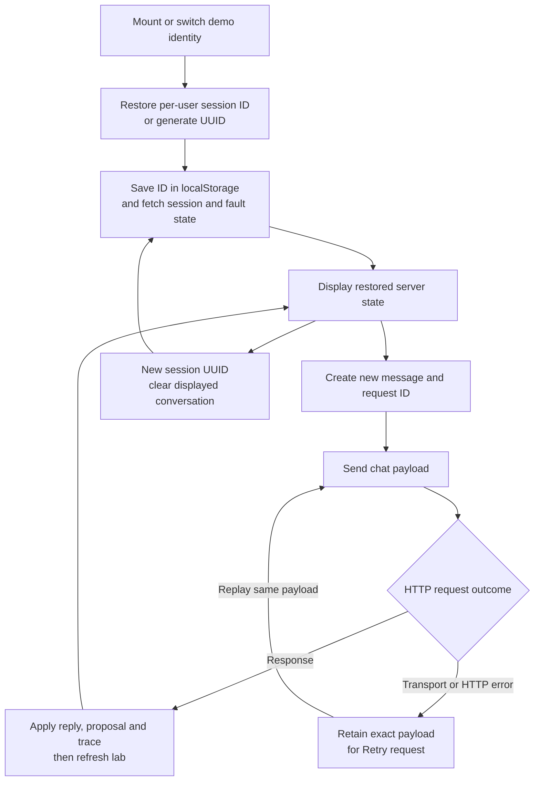

# Frontend design

Bench uses a Next.js App Router page with a React client component. The page presents chat, purchase review, order history, saved context and request traces. Agent reasoning and durable business state remain in the backend.

Sources: [page](../app/page.tsx), [layout](../app/layout.tsx), [styles](../app/globals.css), [proxy route](../app/api/[...path]/route.ts), [Next configuration](../next.config.ts).

## Structure and state

| File                         | Responsibility                                                                                       |
| ---------------------------- | ---------------------------------------------------------------------------------------------------- |
| `app/layout.tsx`             | English document language, page metadata and shared stylesheet.                                      |
| `app/page.tsx`               | Client-side state, API calls, chat and orders views, proposal controls, traces and failure controls. |
| `app/globals.css`            | Layout, component styles and responsive breakpoints. Uses system fonts.                              |
| `app/api/[...path]/route.ts` | Server-side forwarding to the agent service.                                                         |

There is one page component rather than a component directory, external state manager or generated API client. The two views switch through local state; they are not separate routes.

State includes selected demo identity, token, session ID, messages, active proposal, saved lab, provider, latest events/trace ID, orders, text input, busy/error state, failure mode and selected view. The server remains authoritative for receipts, lab memory and active proposals.

## Session and identity lifecycle

`localStorage["bench-session-<user>"]` stores a session ID separately for each demo identity. The bearer token is held in component state; the page does not persist it to localStorage. Switching identity clears displayed context, orders and failed-request state, resets the demo token and restores that identity's session.

Session restoration calls `/api/session` and `/api/faults`. An AbortController cancels stale restoration fetches. Fault-status fetch errors are ignored; session errors are shown. Starting a new session generates a new UUID and clears the conversation/proposal/trace display. User-scoped lab memory survives on the server.

## Sending messages

The API helper sends JSON through same-origin `/api/*` paths and adds the current bearer token. The send handler blocks empty messages, concurrent sends and requests without a session ID.

For a new message it generates a UUID `requestId`, includes the active `proposalId` when present, appends the user's message optimistically and clears the composer. A successful HTTP response updates reply, proposal and trace, then fetches session state to refresh the lab.

This follow-up fetch is part of the same UI try/catch. If it fails after a chat response was received, the interface can still offer transport replay; the cached request ID prevents a second business write. There is no optimistic order creation.

## Purchase review and two kinds of retry

| UI state or action       | Request behavior                                                                                                  |
| ------------------------ | ----------------------------------------------------------------------------------------------------------------- |
| Pending proposal         | Show exact item, supplier, quantity, total and lab; offer Approve and Decline.                                    |
| Approve / Decline        | Send a new chat message with the reviewed proposal ID.                                                            |
| Approved but unconfirmed | Offer **Retry safely** with literal `retry`; suppress decline.                                                    |
| Transport/HTTP error     | Show **Retry request**, which resends the retained payload and request ID without appending another user message. |
| Confirmed receipt        | Show the returned order details; active proposal clears.                                                          |

**Retry request** replays one HTTP request. **Retry safely** is a new request to recover the original approved business operation. The [API contract](api.md#approval-and-replay-rules) explains the two identifiers involved.

Money is formatted from integer cents using `Intl.NumberFormat`. The frontend does not calculate an authoritative stock shortfall or create approval proofs.

## Orders, faults and traces

Opening the purchase-orders view fetches `/api/orders`; the server injects current user scope. The page does not filter a shared cross-user list itself.

The Failure Lab selector calls the authenticated local fault endpoint. Modes are shared by all mock users, even though the control is shown in each user's page. A disabled backend mutation can return an error; the current page has no separate administrator-role model.

Trace delivery happens with the completed response. Expandable events show tool calls, approvals, memory, skill loads and request events; model calls have a separate detail block. The latest cached trace is restored on reload. The UI is not a streaming trace viewer and does not list the entire JSONL history.

## Layout and accessibility

The desktop view places conversation and details in two columns. Styles adjust at 1,150, 900 and 600 pixels; details move below conversation at 900 pixels. The mobile layout hides the demo profile selector, so identity switching is not exposed at every viewport size.

The page includes a polite chat live region, labeled inputs, a Send accessible label and errors with `role="alert"`. No separate automated accessibility suite is present.

## Proxy and client limitations

The proxy uses the Node runtime, resolves async route parameters, disables upstream caching and forwards only allowlisted resources. It has a fixed 35-second timeout. See [HTTP transport](api.md#authentication-and-transport) and [status behavior](api.md#status-codes-and-errors).

Demo profiles are hardcoded to Maya and Theo. Users can edit the bearer field to match custom local tokens, but this is not a production login flow. There are no streaming, cancellation, offline synchronization or end-to-end browser tests in the automated evaluation runner. Changing Next.js code requires consulting the installed framework docs as directed by [AGENTS.md](../AGENTS.md).
